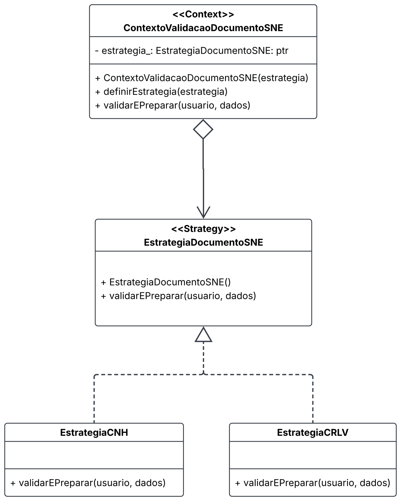
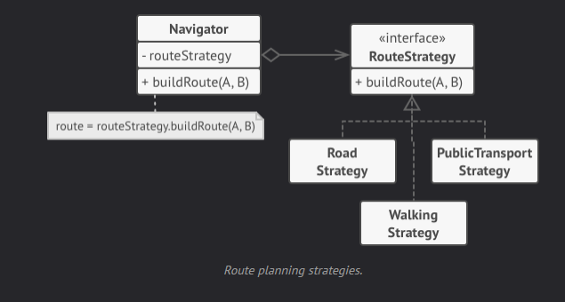

# 1.3. Iniciativas Extras (Padrões de Projeto)

## Matheus Pinheiro - Sub02:

Foi feito estudo e implementação de um padrão comportamental **Strategy**: Usado para implementar variantes de um algoritmo sem uma grande quantidade de condicionais (if/switch) além de auxiliar na integração de novas condições.

Nesta implementação foi utilizado na verificação por CNH ou CRLV, presente em `estrategia_documento_sne.hpp` e também para decisão do desconto entre 20%, 40% ou 0%.

Essa abordagem facilita a manutenção e a extensão do sistema, permitindo adicionar novas estratégias de verificação ou alterar as regras de desconto e promoção com menor impacto no código existente.

### Diagrama Strategy

Fonte: Matheus Pinheiro

---

### Strategy Refactoring Guru

Exemplo Refactoring guru
