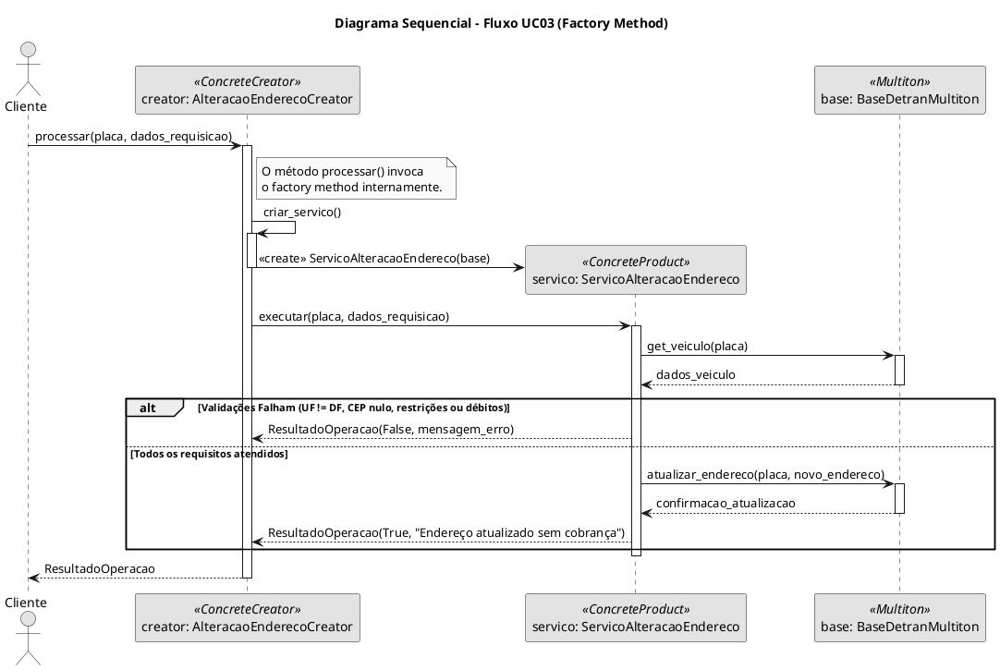
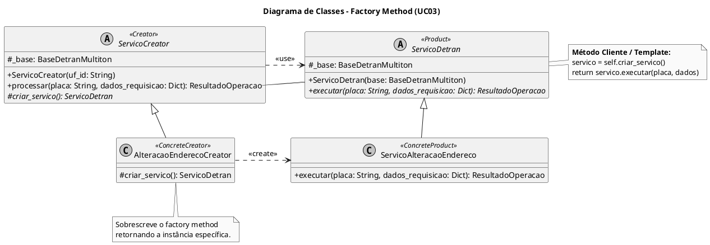

# SubEquipe_01
O relatório deverá conter a estrutura de focos estabelecida a seguir, bem como versionamentos, metodologia e participantes por foco.
Não omitir tópicos.

## Foco do Relatório:
### FOCO_01: GoFs Criacionais & IA Generativa
Entrega Mínima: um GoF Criacional (modelo & código & vídeo com o padrão em execução).
### Participantes no Foco 01
| Nome do Membro | Item Elaborado |
|--|--|
|Ricardo Henrique| Diagrama de Classes - Factory Method|
|Ricardo Henrique| Diagrama Sequencial|
|Ricardo Henrique| Elaboração do Código (Factory Method + Multiton)|
|Ricardo Henrique| Elaboração do Contexto do Problema|

### Metodologia do Foco_01
[LinkVideo]

### GoF Criacional
#### Contexto (Problema)

O caso de uso trabalhado é o **UC03 — Alterar Endereço do Veículo**, do fluxo DETRAN-DF Digital. Nele, o proprietário autenticado informa um novo endereço e um CEP para o veículo, e o sistema só efetiva a alteração se todas as regras de negócio forem satisfeitas: o endereço precisa estar no Distrito Federal, o CEP não pode ser nulo nem de caixa postal, o veículo não pode ter débitos vencidos e não pode haver restrição administrativa ou judicial que impeça a circulação. Se qualquer uma dessas condições falhar, a alteração não ocorre; se todas forem atendidas, o endereço é atualizado gratuitamente.

Ao modelar esse fluxo percebe-se um problema de criação em dois níveis:

1. **Qual serviço instanciar.** O UC03 é um entre vários serviços que o DETRAN-DF Digital oferece (alteração de endereço, consulta de débitos, consulta de restrições etc.), todos acionados a partir de uma mesma ação do cliente (`processar(placa, dados_requisicao)`), mas cada um com sua própria regra de validação. Resolver isso com um `if/elif` dentro do cliente (`if tipo_servico == "alteracao_endereco": ...`) reproduz os mesmos problemas observados em outros fluxos do app: acoplamento do cliente a todas as classes concretas, violação do Open/Closed sempre que um novo serviço é criado, e duplicação da lógica de decisão em cada tela que dispara um serviço.
2. **Quantas bases de dados manter.** O DETRAN é, na prática, operado por unidade federativa. Simular uma base única e global para todos os veículos do país não reflete esse domínio e abre margem para dados conflitantes entre UFs; por outro lado, criar uma instância nova a cada chamada desperdiçaria recursos e impediria compartilhar o mesmo estado entre diferentes serviços que atendem à mesma UF.

Para o primeiro problema, aplica-se o **Factory Method**: a decisão de qual `ServicoDetran` instanciar é delegada a subclasses de um `ServicoCreator`, e o cliente (`processar`) passa a depender apenas da abstração. Incluir um novo serviço do DETRAN (por exemplo, alteração de proprietário) significa criar um novo par Produto/Creator, sem tocar no código existente.

Para o segundo problema, aplica-se o **Multiton**: em vez de uma única instância global (Singleton) ou de instâncias soltas sem controle, a classe `BaseDetranMultiton` garante no máximo **uma instância por chave** (a UF), reaproveitando a mesma base sempre que o mesmo `uf_id` é solicitado. Os dois padrões se complementam no mesmo fluxo: o `ServicoCreator` recebe o `uf_id`, busca a instância correta da base via Multiton, e repassa essa base ao serviço concreto criado pelo Factory Method.

#### Modelagem (Notação UML)
##### Pseudocódigo Orientado a Objetos
Para refletir os objetos levantados (Proprietário, Veículo, Endereço, Débito, Restrição), o pseudocódigo abaixo que realizei tentando deduzir a mão, orienta a validação e a execução do fluxo através de uma classe controladora/de serviço.

```Plaintext
CLASSE Endereco
    ATRIBUTOS: cep, logradouro, uf

CLASSE Veiculo
    ATRIBUTOS: placa, renavam, enderecoAtual, debitos, restricoes
    METODO possui_debitos_vencidos() -> BOLEANO
    METODO possui_restricoes_circulacao() -> BOLEANO
    METODO atualizar_endereco(novoEndereco)

CLASSE ServicoAlteracaoEndereco
    METODO executar(veiculo, novoEndereco) -> RESULTADO
        SE novoEndereco.uf != "DF" ENTAO
            RETORNAR ERRO("Endereço deve estar no Distrito Federal")
        
        SE novoEndereco.cep == NULO OU eh_caixa_postal(novoEndereco.cep) ENTAO
            RETORNAR ERRO("CEP inválido ou caixa postal não permitida")
            
        SE veiculo.possui_debitos_vencidos() ENTAO
            RETORNAR ERRO("Débitos vencidos devem estar quitados")
            
        SE veiculo.possui_restricoes_circulacao() ENTAO
            RETORNAR ERRO("Veículo possui restrição impeditiva")
            
        veiculo.atualizar_endereco(novoEndereco)
        RETORNAR SUCESSO("Endereço atualizado gratuitamente")
```
##### Diagrama Sequencial
Este diagrama dinâmico mostra a interação no tempo. Ele ilustra como o cliente interage apenas com a abstração do Creator (processar), que internamente invoca o Factory Method (criar_servico) para instanciar o produto correto e executar as validações de negócio e regras do DETRAN-DF.

<div style="text-align: center; margin-bottom: 40px; width: 100%;">
  <h4>Diagrama Sequencial</h4>
  
  <br>
  <em style="color: #666; font-size: 0.9em;">Figura 1 | Elaboração: Ricardo Henrique</em>
</div>
<br> </br>
- PlantUml



#### Diagrama de Classes - Factory Method
Este diagrama estático isola a visualização da família Factory Method. Ele evidencia a relação de herança (<|--) e a injeção de criação (<<create>>), destacando como o padrão move a decisão de qual serviço instanciar para as subclasses, aderindo ao princípio do encapsulamento da criação.

<div style="text-align: center; margin-bottom: 40px; width: 100%;">
  <h4>Diagrama de Classes - Factory Method</h4>
  
  <br>
  <em style="color: #666; font-size: 0.9em;">Figura 2 | Elaboração: Ricardo Henrique</em>
</div>



> **Nota:** o Multiton (`BaseDetranMultiton`) não aparece como participante formal do Factory Method, mas é injetado no Creator e repassado ao Produto por isso compõe o diagrama sequencial acima como colaborador externo aos dois padrões.

#### Implementação (Código & Vídeo com Padrão em Execução)
Explicar cada trecho de código, inerente aos participantes do padrão. 
Conferir um link para o código hospedado no repositorio do projeto.
Acordar um vídeo, demonstrando o código em execução.

#
## Versionamentos
|Nome do Membro | Contribuição | Data

EXEMPLO:
| Fulano  |  1. Elaboração do Padrão de Projeto GoF Criacional Builder, com modelagem em UML, código e execução & Ponto de Vista sobre o Uso de IA Generativa | XX/XX/XXXX
OBS: TODOS DEVEM PARTICIPAR, MOSTRANDO SEUS PONTOS DE VISTA E COMO COLABORARAM NA ENTREGA.

--
# Observações: 
Entregável: Relatório, documentado no GitPages, revelando:
## Entrega Mínima: um subgrupo com um GoF Criacional (modelo & código & vídeo com o padrão em execução), um subgrupo em um GoF Estrutural (modelo & código & vídeo com o padrão em execução), um subgrupo com um GoF Comportamental (modelo & código & vídeo com o padrão em execução) e pontos de vista de cada membro da equipe sobre as lições aprendidas e uso da IA Generativa. Mira-se no MM, com a entrega mínima.

## Como ir além, para conseguir menções superiores?
Embasar cada artefato gerado e cada decisão tomada na literatura;
Manter rastros claros para o trabalho em equipe (ex. vídeos das reuniões e atas bem elaboradas), evidenciando práticas metodológicas (ex. reuniões periódicas das metodologias ágeis; checklists; debates, e assim vai);
Modelo & Código & Padrão Rodando bem esclarecidos, e
Reportar os pontos de vista de forma fundamentada, clara e com senso crítico.

## 📌A ideia não é quantidade, e sim qualidade do que é entregue.

## Apresentação:
Apresentação (para a professora) explicando o artefato elaborado, com: (i) rastro claro aos membros participantes (MOSTRAR QUADRO DE PARTICIPAÇÕES & COMMITS); (ii) justificativas & senso crítico sobre o trabalho realizado, e (iii) comentários gerais sobre o trabalho em equipe. Tempo da Apresentação: +/- 10min. Recomendação: Apresentar diretamente via Wiki ou GitPages do Projeto. Baixar os conteúdos com antecedência, evitando problemas de internet no momento de exposição nas Dinâmicas de Avaliação.

A Wiki ou GitPages do Projeto deve conter, PARA CADA SUBGRUPO, um tópico dedicado ao relatório com a entrega mínima, versionamentos, referências, e demais detalhamentos gerados pela equipe nesse escopo.
Demais orientações disponíveis nas Diretrizes (vide Aprender3).
