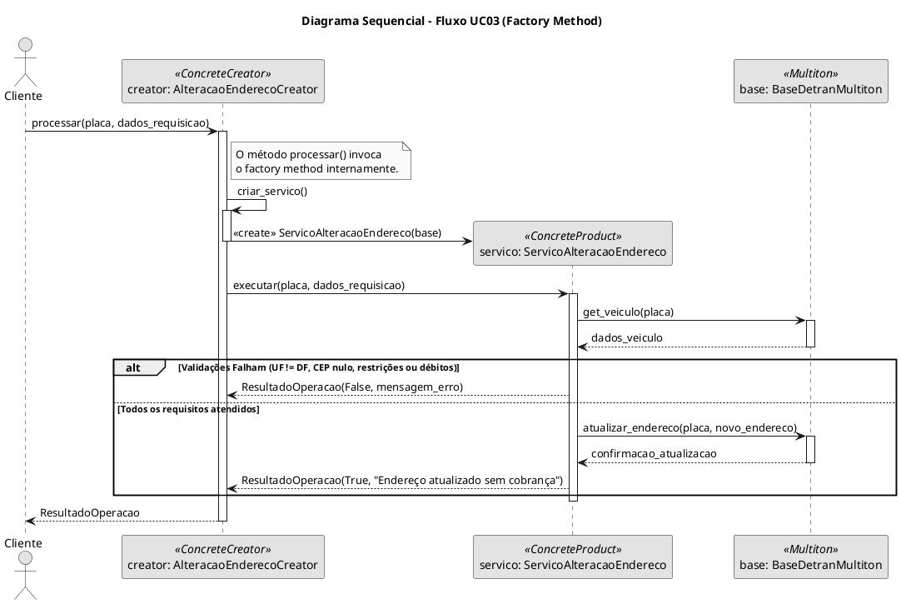
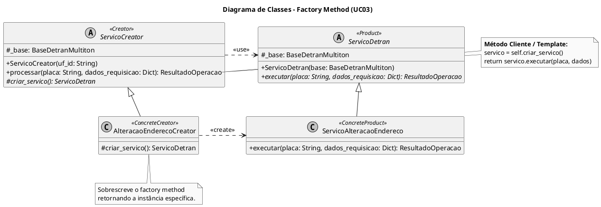

# SubEquipe_01
O relatório deverá conter a estrutura de focos estabelecida a seguir, bem como versionamentos, metodologia e participantes por foco.
Não omitir tópicos.

## Foco do Relatório:
### FOCO_01: GoFs Criacionais & IA Generativa
Entrega Mínima: um GoF Criacional (modelo & código & vídeo com o padrão em execução).
### Participantes no Foco 01
| Nome do Membro | Item Elaborado |
|--|--|
|Ricardo Henrique| Diagrama de Classes - Factory Method|
|Ricardo Henrique| Diagrama Sequencial|
|Ricardo Henrique| Elaboração do Código (Factory Method + Multiton)|
|Ricardo Henrique| Elaboração do Contexto do Problema|

### Metodologia do Foco_01
[LinkVideo]

### GoF Criacional
#### Contexto (Problema)

O caso de uso trabalhado é o **UC03 — Alterar Endereço do Veículo**, do fluxo DETRAN-DF Digital. Nele, o proprietário autenticado informa um novo endereço e um CEP para o veículo, e o sistema só efetiva a alteração se todas as regras de negócio forem satisfeitas: o endereço precisa estar no Distrito Federal, o CEP não pode ser nulo nem de caixa postal, o veículo não pode ter débitos vencidos e não pode haver restrição administrativa ou judicial que impeça a circulação. Se qualquer uma dessas condições falhar, a alteração não ocorre; se todas forem atendidas, o endereço é atualizado gratuitamente.

Ao modelar esse fluxo percebe-se um problema de criação em dois níveis:

1. **Qual serviço instanciar.** O UC03 é um entre vários serviços que o DETRAN-DF Digital oferece (alteração de endereço, consulta de débitos, consulta de restrições etc.), todos acionados a partir de uma mesma ação do cliente (`processar(placa, dados_requisicao)`), mas cada um com sua própria regra de validação. Resolver isso com um `if/elif` dentro do cliente (`if tipo_servico == "alteracao_endereco": ...`) reproduz os mesmos problemas observados em outros fluxos do app: acoplamento do cliente a todas as classes concretas, violação do Open/Closed sempre que um novo serviço é criado, e duplicação da lógica de decisão em cada tela que dispara um serviço.
2. **Quantas bases de dados manter.** O DETRAN é, na prática, operado por unidade federativa. Simular uma base única e global para todos os veículos do país não reflete esse domínio e abre margem para dados conflitantes entre UFs; por outro lado, criar uma instância nova a cada chamada desperdiçaria recursos e impediria compartilhar o mesmo estado entre diferentes serviços que atendem à mesma UF.

Para o primeiro problema, aplica-se o **Factory Method**: a decisão de qual `ServicoDetran` instanciar é delegada a subclasses de um `ServicoCreator`, e o cliente (`processar`) passa a depender apenas da abstração. Incluir um novo serviço do DETRAN (por exemplo, alteração de proprietário) significa criar um novo par Produto/Creator, sem tocar no código existente.

Para o segundo problema, aplica-se o **Multiton**: em vez de uma única instância global (Singleton) ou de instâncias soltas sem controle, a classe `BaseDetranMultiton` garante no máximo **uma instância por chave** (a UF), reaproveitando a mesma base sempre que o mesmo `uf_id` é solicitado. Os dois padrões se complementam no mesmo fluxo: o `ServicoCreator` recebe o `uf_id`, busca a instância correta da base via Multiton, e repassa essa base ao serviço concreto criado pelo Factory Method.

#### Modelagem (Notação UML)
##### Pseudocódigo Orientado a Objetos
Para refletir os objetos levantados (Proprietário, Veículo, Endereço, Débito, Restrição), o pseudocódigo abaixo que realizei tentando deduzir a mão, orienta a validação e a execução do fluxo através de uma classe controladora/de serviço.

```Plaintext
CLASSE Endereco
    ATRIBUTOS: cep, logradouro, uf

CLASSE Veiculo
    ATRIBUTOS: placa, renavam, enderecoAtual, debitos, restricoes
    METODO possui_debitos_vencidos() -> BOLEANO
    METODO possui_restricoes_circulacao() -> BOLEANO
    METODO atualizar_endereco(novoEndereco)

CLASSE ServicoAlteracaoEndereco
    METODO executar(veiculo, novoEndereco) -> RESULTADO
        SE novoEndereco.uf != "DF" ENTAO
            RETORNAR ERRO("Endereço deve estar no Distrito Federal")
        
        SE novoEndereco.cep == NULO OU eh_caixa_postal(novoEndereco.cep) ENTAO
            RETORNAR ERRO("CEP inválido ou caixa postal não permitida")
            
        SE veiculo.possui_debitos_vencidos() ENTAO
            RETORNAR ERRO("Débitos vencidos devem estar quitados")
            
        SE veiculo.possui_restricoes_circulacao() ENTAO
            RETORNAR ERRO("Veículo possui restrição impeditiva")
            
        veiculo.atualizar_endereco(novoEndereco)
        RETORNAR SUCESSO("Endereço atualizado gratuitamente")
```
##### Diagrama Sequencial
Este diagrama dinâmico mostra a interação no tempo. Ele ilustra como o cliente interage apenas com a abstração do Creator (processar), que internamente invoca o Factory Method (criar_servico) para instanciar o produto correto e executar as validações de negócio e regras do DETRAN-DF.

<div style="text-align: center; margin-bottom: 40px; width: 100%;">
  <h4>Diagrama Sequencial</h4>
  
  <br>
  <em style="color: #666; font-size: 0.9em;">Figura 1 | Elaboração: Ricardo Henrique</em>
</div>
<br> </br>
- PlantUml



#### Diagrama de Classes - Factory Method
Este diagrama estático isola a visualização da família Factory Method. Ele evidencia a relação de herança (<|--) e a injeção de criação (<<create>>), destacando como o padrão move a decisão de qual serviço instanciar para as subclasses, aderindo ao princípio do encapsulamento da criação.

<div style="text-align: center; margin-bottom: 40px; width: 100%;">
  <h4>Diagrama de Classes - Factory Method</h4>
  
  <br>
  <em style="color: #666; font-size: 0.9em;">Figura 2 | Elaboração: Ricardo Henrique</em>
</div>



> **Nota:** o Multiton (`BaseDetranMultiton`) não aparece como participante formal do Factory Method, mas é injetado no Creator e repassado ao Produto por isso compõe o diagrama sequencial acima como colaborador externo aos dois padrões.

#### Implementação (Código & Vídeo com Padrão em Execução)
### Implementação do diagrama em código

```python
from abc import ABC, abstractmethod
from typing import Dict, List
from dataclasses import dataclass

# ==========================================
# 1. MULTITON: Gerenciador de Bases do Detran
# ==========================================
class BaseDetranMultiton:
    """
    Multiton que permite a criação de instâncias limitadas da base de dados,
    gerenciadas por uma chave (ex: por Unidade Federativa).
    """
    _instances: Dict[str, 'BaseDetranMultiton'] = {}

    def __new__(cls, uf_id: str):
        if uf_id not in cls._instances:
            instance = super().__new__(cls)
            instance.uf_id = uf_id
            # Simulação do banco de dados de veículos (Placa -> Dados)
            instance.veiculos = {
                "JKA1234": {
                    "proprietario": "Ricardo",
                    "debitos_vencidos": False,
                    "restricoes": False,
                    "endereco_atual": {"uf": "DF", "cep": "70000-000"}
                }
            }
            cls._instances[uf_id] = instance
        return cls._instances[uf_id]

    @classmethod
    def get_instance(cls, uf_id: str) -> 'BaseDetranMultiton':
        return cls(uf_id)

@dataclass
class ResultadoOperacao:
    sucesso: bool
    mensagem: str

# ==========================================
# 2. FACTORY METHOD: Products
# ==========================================
class ServicoDetran(ABC):
    """
    Product: define a interface para os serviços que serão criados pelo factory method.
    """
    def __init__(self, base: BaseDetranMultiton) -> None:
        self._base = base

    @abstractmethod
    def executar(self, placa: str, dados_requisicao: dict) -> ResultadoOperacao:
        pass

class ServicoAlteracaoEndereco(ServicoDetran):
    """
    Concrete Product: Implementa as regras do fluxo UC03.
    """
    def executar(self, placa: str, dados_requisicao: dict) -> ResultadoOperacao:
        novo_endereco = dados_requisicao.get("novo_endereco", {})
        veiculo = self._base.veiculos.get(placa)

        if not veiculo:
            return ResultadoOperacao(False, "Veículo não encontrado.")

        # Validações do UC03
        if novo_endereco.get("uf") != "DF":
            return ResultadoOperacao(False, "Endereço deve estar no Distrito Federal. (Requer outro fluxo)")

        cep = novo_endereco.get("cep")
        if not cep or novo_endereco.get("is_caixa_postal"):
            return ResultadoOperacao(False, "CEP obrigatório e não pode ser caixa postal.")

        if veiculo.get("debitos_vencidos"):
            return ResultadoOperacao(False, "Débitos vencidos devem estar quitados.")

        if veiculo.get("restricoes"):
            return ResultadoOperacao(False, "Não pode existir restrição administrativa ou judicial.")

        # Satisfeitos os requisitos, atualiza
        veiculo["endereco_atual"] = novo_endereco
        return ResultadoOperacao(True, "Endereço cadastrado do veículo atualizado, sem cobrança.")

# ==========================================
# 3. FACTORY METHOD: Creators
# ==========================================
class ServicoCreator(ABC):
    """
    Creator: declara o factory method que retorna um objeto do tipo ServicoDetran.
    """
    def __init__(self, uf_id: str) -> None:
        # Integração com o Multiton para injetar a base de dados correta
        self._base = BaseDetranMultiton.get_instance(uf_id)

    @abstractmethod
    def criar_servico(self) -> ServicoDetran:
        """Factory Method"""
        pass

    def processar(self, placa: str, dados_requisicao: dict) -> ResultadoOperacao:
        # Delega a instanciação à subclasse e executa a operação principal
        servico = self.criar_servico()
        return servico.executar(placa, dados_requisicao)

class AlteracaoEnderecoCreator(ServicoCreator):
    """
    Concrete Creator: sobrescreve o factory method para instanciar o serviço correto.
    """
    def criar_servico(self) -> ServicoDetran:
        return ServicoAlteracaoEndereco(self._base)

# ==========================================
# TESTE DO PADRÃO EM EXECUÇÃO
# ==========================================
if __name__ == "__main__":
    # Cliente depende apenas das abstrações para disparar o serviço
    creator = AlteracaoEnderecoCreator(uf_id="DF")

    requisicao = {
        "novo_endereco": {
            "uf": "DF",
            "cep": "71000-000",
            "is_caixa_postal": False
        }
    }

    resultado = creator.processar(placa="JKA1234", dados_requisicao=requisicao)
    print(f"Status: {'[SUCESSO]' if resultado.sucesso else '[FALHA]'} {resultado.mensagem}")
```
* **`BaseDetranMultiton`** — é o Multiton propriamente dito. O `__new__` intercepta a criação e consulta o dicionário de classe `_instances` pela chave `uf_id`; se já existe uma base para aquela UF, ela é reaproveitada, caso contrário uma nova é criada e registrada. Isso garante no máximo uma base por UF em todo o processo, sem exigir que o cliente gerencie esse ciclo de vida manualmente.
* **`ServicoDetran`** (Product) e **`ServicoAlteracaoEndereco`** (Concrete Product) — concentram as regras do UC03 (UF obrigatoriamente DF, CEP obrigatório e não caixa-postal, ausência de débitos vencidos, ausência de restrições). O método `executar` reproduz fielmente a decisão descrita no pseudocódigo do caso de uso: qualquer validação que falhe retorna um `ResultadoOperacao` de erro; todas satisfeitas, o endereço é atualizado e o resultado indica sucesso sem cobrança.
* **`ServicoCreator`** (Creator) e **`AlteracaoEnderecoCreator`** (Concrete Creator) — isolam a criação do serviço. `processar()` é o método "template" que o cliente chama; internamente ele invoca o factory method `criar_servico()`, que cada Creator concreto sobrescreve para devolver o Produto correspondente. O construtor do Creator já resolve a base correta via `BaseDetranMultiton.get_instance(uf_id)`, conectando os dois padrões.
* **Cliente** — no bloco de teste (`if __name__ == "__main__":`), o cliente só conhece `AlteracaoEnderecoCreator` e `ResultadoOperacao`; nunca instancia `ServicoAlteracaoEndereco` diretamente, o que confirma a inversão de controle buscada pelo Factory Method.

*Link do código no repositório do projeto:* [inserir link do arquivo `Factory Method + Multiton.py` no repositório]
*Vídeo com o padrão em execução:* [inserir link do vídeo demonstrando a execução do script]

## Uso da IA Generativa (SENSO CRÍTICO)

A inteligência artificial (Claude) foi utilizada como apoio em três frentes: (1) tradução do pseudocódigo do UC03 em um modelo de classes e um fluxo sequencial coerentes com o GoF Factory Method; (2) revisão crítica da decisão de onde o Multiton deveria se encaixar, para não confundi-lo com um Singleton simples; e (3) geração e ajuste do código PlantUML dos diagramas a partir do código Python final.

#### Exemplo de uso para modelagem a partir do pseudocódigo

*prompt:* "Tenho este pseudocódigo do UC03 (classe `Endereco`, `Veiculo` e `ServicoAlteracaoEndereco`, com as validações de UF, CEP, débitos e restrições). Quero aplicar Factory Method para que o serviço seja criado por um Creator, e usar Multiton para controlar uma base de dados por UF. Isso faz sentido para esse domínio?"

*resultado:* a IA confirmou que o Factory Method se aplica bem à criação do serviço (um Creator por tipo de serviço do DETRAN, com um método de criação sobrescrito), e sugeriu que o Multiton fosse usado apenas para a base de dados — não para o próprio serviço — já que o serviço depende dos dados da requisição a cada chamada, enquanto a base de dados é o recurso que faz sentido restringir a uma instância por UF.

**Validação e decisão:** conferi a sugestão com o material da disciplina sobre GoFs criacionais e optei por manter o Multiton restrito à classe `BaseDetranMultiton`, injetada no Creator e repassada ao Produto, exatamente como representado no diagrama de sequência.

#### Apoio da IA na elaboração do código e dos diagramas

O código final (`Factory Method + Multiton.py`) foi desenvolvido com apoio do Claude a partir do pseudocódigo original do UC03: a IA sugeriu a separação em Product/Concrete Product e Creator/Concrete Creator, e eu revisei, executei e adaptei as mensagens de erro e o formato de retorno (`ResultadoOperacao`). O mesmo vale para os diagramas (`Diagrama Sequencial.txt` e `Diagrama de Classes - Factory Method.txt`), cujo código PlantUML foi gerado com auxílio da IA a partir do código Python e depois conferido linha a linha contra as classes e métodos implementados, para garantir que nomes e assinaturas fossem idênticos entre código e modelo.

## Versionamentos
|Nome do Membro | Contribuição | Data

EXEMPLO:
| Fulano  |  1. Elaboração do Padrão de Projeto GoF Criacional Builder, com modelagem em UML, código e execução & Ponto de Vista sobre o Uso de IA Generativa | XX/XX/XXXX
OBS: TODOS DEVEM PARTICIPAR, MOSTRANDO SEUS PONTOS DE VISTA E COMO COLABORARAM NA ENTREGA.

--
# Observações: 
Entregável: Relatório, documentado no GitPages, revelando:
## Entrega Mínima: um subgrupo com um GoF Criacional (modelo & código & vídeo com o padrão em execução), um subgrupo em um GoF Estrutural (modelo & código & vídeo com o padrão em execução), um subgrupo com um GoF Comportamental (modelo & código & vídeo com o padrão em execução) e pontos de vista de cada membro da equipe sobre as lições aprendidas e uso da IA Generativa. Mira-se no MM, com a entrega mínima.

## Como ir além, para conseguir menções superiores?
Embasar cada artefato gerado e cada decisão tomada na literatura;
Manter rastros claros para o trabalho em equipe (ex. vídeos das reuniões e atas bem elaboradas), evidenciando práticas metodológicas (ex. reuniões periódicas das metodologias ágeis; checklists; debates, e assim vai);
Modelo & Código & Padrão Rodando bem esclarecidos, e
Reportar os pontos de vista de forma fundamentada, clara e com senso crítico.

## 📌A ideia não é quantidade, e sim qualidade do que é entregue.

## Apresentação:
Apresentação (para a professora) explicando o artefato elaborado, com: (i) rastro claro aos membros participantes (MOSTRAR QUADRO DE PARTICIPAÇÕES & COMMITS); (ii) justificativas & senso crítico sobre o trabalho realizado, e (iii) comentários gerais sobre o trabalho em equipe. Tempo da Apresentação: +/- 10min. Recomendação: Apresentar diretamente via Wiki ou GitPages do Projeto. Baixar os conteúdos com antecedência, evitando problemas de internet no momento de exposição nas Dinâmicas de Avaliação.

A Wiki ou GitPages do Projeto deve conter, PARA CADA SUBGRUPO, um tópico dedicado ao relatório com a entrega mínima, versionamentos, referências, e demais detalhamentos gerados pela equipe nesse escopo.
Demais orientações disponíveis nas Diretrizes (vide Aprender3).
