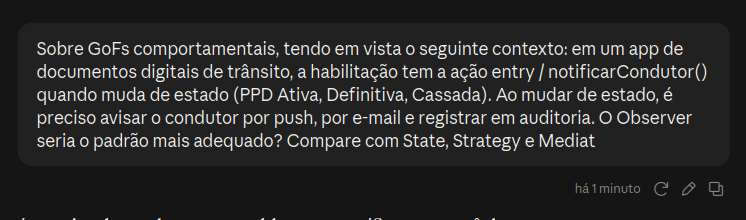
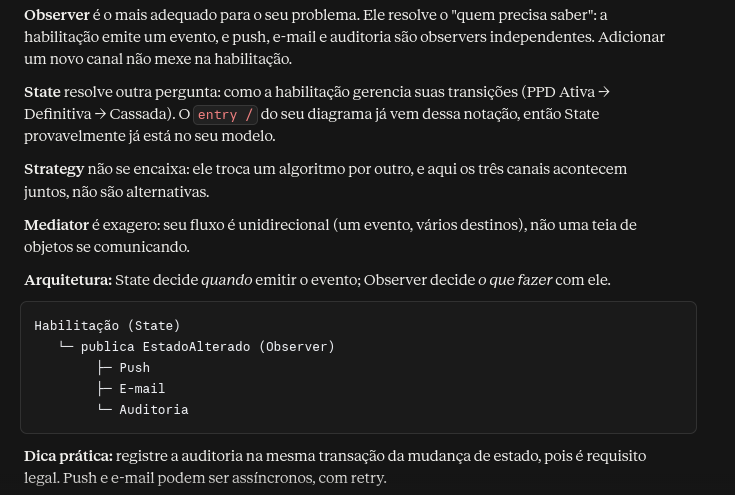
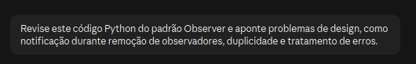
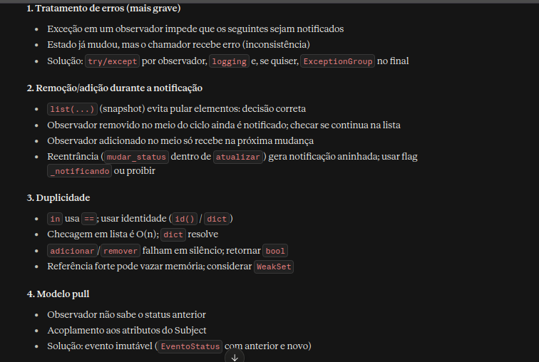
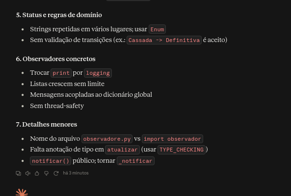

# SubEquipe_03
O relatório deverá conter a estrutura de focos estabelecida a seguir, bem como versionamentos, metodologia e participantes por foco.
Não omitir tópicos.

## Focos do Relatório:

### FOCO_03: GoFs Comportamentais & IA Generativa

Entrega Mínima: um GoF Comportamental (modelo & código & vídeo com o padrão em execução).

### Participantes no Foco_03

| Nome do Membro | Item Elaborado |
|--|--|
|Lara Souza Mota| Contexto do problema e justificativa da escolha do Observer|
|Lara Souza Mota| Diagrama de Classes - Observer|
|Lara Souza Mota| Diagrama de Sequência - Observer|
|Lara Souza Mota| Implementação em Python (Observer) e testes automatizados|
|Lara Souza Mota| Vídeo com o padrão em execução|
|Lara Souza Mota| Uso crítico da IA Generativa e lições aprendidas|


### Metodologia do Foco_03

Seguindo a [Ata n.º 01](1.1.3.SubEquipe_03.md), cada uma da equipe fez a sua entrega em um arquivo individual. Como a Beatriz já tinha pegado o State, escolhi o **Observer**, que combina com ele: o State decide *quando* a habilitação muda de estado, e o Observer *avisa quem precisa saber* disso, que é o `entry / notificarCondutor()` da Máquina de Estados da Entrega 2.

Fui fazendo na seguinte ordem:

**1. Partindo do que já existia**

- [x] Voltei na [Máquina de Estados da `Habilitacao`](https://unbarqdsw2026-2-turma02.github.io/2026.2-T02-_G6_ProjetoAplicativoMovel_Entrega02/#/Base/Relatorios/1.1.3.SubEquipe_03?id=m%c3%a1quina-de-estados-habilitacao) (Entrega 2) para achar onde a notificação aparecia
- [x] Conversei com a Beatriz para não repetir o padrão dela

**2. Diagramas**

- [x] Diagrama de Classes e Diagrama de Sequência, os dois feitos no draw.io
- [x] Revisei os dois depois de ver que o primeiro saiu com a caixa do Subject desalinhada

**3. Código em Python**

- [x] Subject, Observer e os três observadores (push, e-mail e auditoria)
- [x] 8 testes com `unittest`, rodando todos com sucesso
- [x] Movi a pasta do código para dentro da pasta do subgrupo, a pedido da Beatriz
- [x] Conferi as imagens do relatório rodando o site localmente

**4. Vídeo**

- [ ] Gravar o código rodando

### GoF Comportamental
 
#### Contexto (Problema)
 
Na Máquina de Estados da `Habilitacao` (Entrega 2), a entrada em cada estado (`PPD Ativa`, `Definitiva` ou `Cassada`) dispara a ação `entry / notificarCondutor()`. Quando o status muda, várias partes do sistema precisam reagir: o condutor deve receber uma **notificação push**, um **e-mail** e a mudança deve ficar registrada em uma **auditoria**.
 
Sem um padrão, a classe que controla o status chamaria cada um desses recursos diretamente:

```python
def mudar_status(self, novo_status):
    self.status = novo_status
    self.push.enviar(self.condutor, novo_status)     # acoplado ao push
    self.email.enviar(self.condutor, novo_status)    # acoplado ao e-mail
    self.auditoria.registrar(self.condutor, novo_status)  # acoplado à auditoria
```
Essa abordagem é problemática, pois causa:

   * Acoplamento forte: a classe de status conhece cada canal de notificação e precisa ser editada sempre que um canal é criado ou removido (por exemplo, SMS ou WhatsApp).
   * Violação do Open/Closed: incluir um novo destinatário da mudança obriga a alterar o código existente.
   * Baixa flexibilidade: não há como ligar ou desligar um canal em tempo de execução (por exemplo, o condutor desativa o e-mail).
Aqui entra o Observer:
  O padrão define uma dependência **um-para-muitos**: o Subject (`AcompanhamentoHabilitacao`) mantém uma lista de observadores e os notifica quando o status muda, sem conhecer o que cada um faz. Incluir um novo canal significa criar uma classe `Observador`, sem alterar o Subject.


#### Por que o Observer (e não outro GoF Comportamental)
 
O GoF define a intenção do Observer como estabelecer uma dependência um-para-muitos entre objetos, de modo que, quando um muda de estado, todos os seus dependentes são notificados e atualizados automaticamente (GAMMA et al., 1995). A escolha se justifica por quatro motivos:
 
1. **O gancho já existia.** A Máquina de Estados da Entrega 2 prevê `entry / notificarCondutor()`; o Observer é a forma de implementar essa notificação de maneira desacoplada, mantendo rastreabilidade com o modelo anterior.
2. **Um evento, vários interessados.** A mesma mudança de status interessa a push, e-mail e auditoria, e o Subject não deve conhecer cada um deles.
3. **Observadores dinâmicos.** `adicionar()` e `remover()` permitem ligar e desligar canais em tempo de execução.
4. **Complementa o State da Beatriz.** O State resolve *como a habilitação se comporta em cada estado*; o Observer resolve *quem é avisado quando o estado muda*. Os dois resolvem problemas diferentes do mesmo fluxo.
**Padrões comparados:**
 
| Padrão | Por que não foi escolhido para este problema |
|---|---|
| **State** | Já adotado pela Beatriz para o comportamento que varia conforme o estado. Não resolve a notificação de vários interessados. |
| **Strategy** | Troca *um* algoritmo por vez, escolhido pelo cliente. Aqui são *vários* receptores reagindo ao mesmo evento. |
| **Mediator** | Centraliza a comunicação entre objetos que se conhecem de forma bidirecional. Aqui a comunicação é de via única (Subject → observadores) e não há interação entre os receptores. |
 
##### Elos com as entregas anteriores

| Artefato anterior | O que vira no Observer |
|---|---|
| [Entrega 2 - Máquina de Estados](https://unbarqdsw2026-2-turma02.github.io/2026.2-T02-_G6_ProjetoAplicativoMovel_Entrega02/#/Base/Relatorios/1.1.3.SubEquipe_03?id=m%c3%a1quina-de-estados-habilitacao): ação `entry / notificarCondutor()` | `AcompanhamentoHabilitacao.notificar()` |
| Entrega 2 - estados `PPD Ativa`, `Definitiva`, `Cassada` | Valores de `status` do Subject; cada mudança dispara a notificação |
| [Entrega 3 - State (Beatriz)](1.1.3.SubEquipe_03_Beatriz.md) | O State muda o estado; o Observer avisa os interessados (integração possível: `ao_entrar()` chamar `notificar()`) |

#### Modelagem (Notação UML)
 
| Papel no GoF Observer (GAMMA et al., 1995) | Classe | Responsabilidade |
|---|---|---|
| **Subject** | `AcompanhamentoHabilitacao` | Guarda o status, mantém a lista de observadores (`adicionar`, `remover`) e os notifica (`notificar`) |
| **Observer** | `Observador` (classe abstrata) | Declara a operação `atualizar()`, chamada a cada mudança |
| **ConcreteObserver** | `NotificacaoPush`, `NotificacaoEmail`, `HistoricoAuditoria` | Reagem à mudança, cada um à sua maneira |

#### Diagrama de Classes - Observer


*Figura 1 | Elaboração: Lara Souza*

**Decisões de modelagem:**
 
- **Associação `AcompanhamentoHabilitacao` → `Observador` com multiplicidade `0..*`:** o Subject conhece apenas a interface abstrata, nunca as classes concretas.
- **`Observador` abstrata (itálico):** obriga todo novo observador a implementar `atualizar()`. Em Python, isso é feito com `ABC` e `@abstractmethod`.
- **Dependência `«usa»` de `Observador` para o Subject:** `atualizar(acompanhamento)` recebe o Subject como parâmetro e lê o status dele (modelo *pull*), em vez de o Subject empurrar os dados.
- **Nota com o código de `notificar()`:** mostra o laço que percorre a lista, que é a essência do padrão.
- **`Client` com dependência `«usa»`:** é o cliente que registra os observadores e dispara a mudança.

 

 *Figura 2 | Elaboração: Lara Souza*

O diagrama mostra primeiro o **registro** dos três observadores (mensagens 1 a 3) e depois a **mudança de status** (mensagem 4). Em `notificar()`, o fragmento `loop` percorre a lista e chama `atualizar(self)` em cada observador (mensagens 6 a 8). O Subject não sabe o que cada observador faz com a informação.
 
**Mapeamento Máquina de Estados → código:**
 
| Elemento da Máquina de Estados / problema | Elemento no Observer |
|---|---|
| `entry / notificarCondutor()` | `AcompanhamentoHabilitacao.notificar()` |
| Estados `PPD Ativa`, `Definitiva`, `Cassada` | Valores de `status`; `mudar_status()` valida e dispara a notificação |
| Canal que avisa o condutor | `NotificacaoPush` e `NotificacaoEmail` |
| Registro da mudança | `HistoricoAuditoria` |
 
#### Implementação (Código & Vídeo com Padrão em Execução)

[Código da Implementação - Observer](https://github.com/UnBArqDsw2026-2-Turma02/2026.2-T02-_G6_ProjetoAplicativoMovel_Entrega03/tree/feature/subequipe-3/docs/Base/Relatorios/SubEquipe_03/codigo/observer)

Estrutura dos arquivos:
 
| Participante | Arquivo |
|---|---|
| Observer | `observador.py` |
| Subject | `acompanhamento_habilitacao.py` |
| ConcreteObservers | `observadores.py` |
| Demonstração | `main.py` |
| Testes | `test_observer.py` |
 
 ##### Observer (`observador.py`)
 
A interface comum. Em Python, `ABC` e `@abstractmethod` garantem que nenhum observador concreto seja criado sem implementar `atualizar()`.
 
```python
class Observador(ABC):
    @abstractmethod
    def atualizar(self, acompanhamento) -> None:
        """Chamado pelo Subject a cada mudança de status."""
```
 
##### Subject (`acompanhamento_habilitacao.py`)
 
Mantém a lista de observadores e o status. Os três métodos centrais do padrão são `adicionar` (*attach*), `remover` (*detach*) e `notificar` (*notify*).
 
```python
def adicionar(self, observador):
    if observador not in self._observadores:
        self._observadores.append(observador)
 
def notificar(self):
    for observador in list(self._observadores):
        observador.atualizar(self)
 
def mudar_status(self, novo_status):
    if novo_status not in STATUS_VALIDOS:
        raise ValueError(f"Status inválido: {novo_status}")
    if novo_status == self._status:
        return  # sem mudança, ninguém é notificado
    self._status = novo_status
    self.notificar()
```
 
Pontos de atenção: o `if novo_status == self._status` evita notificações repetidas; a validação do status ocorre **antes** da mudança, então um valor inválido não notifica ninguém; e o laço percorre uma **cópia** da lista (`list(...)`), o que evita erro caso um observador se remova durante a notificação.
 
##### ConcreteObservers (`observadores.py`)
 
Cada observador reage à mudança do seu jeito, lendo o status no Subject (modelo *pull*).
 
```python
class NotificacaoPush(Observador):
    def atualizar(self, acompanhamento):
        msg = f"[PUSH] {acompanhamento.condutor}: {MENSAGENS[acompanhamento.status]}"
        self.enviadas.append(msg)
        print(msg)
```
 
`NotificacaoEmail` e `HistoricoAuditoria` seguem a mesma estrutura. Para criar um novo canal (por exemplo, SMS), basta uma nova classe que herde de `Observador`, **sem alterar o Subject**.

##### Demonstração (`main.py`)
 
O cliente registra os observadores, muda o status e mostra que a remoção de um observador e a repetição do mesmo status funcionam como esperado.
 
```
=== 2. PPD concluída sem infração: Definitiva ===
[PUSH] Condutor Exemplo: Parabéns! Sua CNH agora é definitiva.
[E-MAIL] Para: Condutor Exemplo | Assunto: Habilitação Definitiva
[AUDITORIA] Condutor Exemplo -> Definitiva
 
=== 3. Removendo o e-mail; nova mudança notifica só os demais ===
[PUSH] Condutor Exemplo: Sua Permissão Para Dirigir foi cassada. Procure o Detran.
[AUDITORIA] Condutor Exemplo -> Cassada
 
=== 4. Mesmo status de novo: ninguém é notificado ===
```
##### Testes (`test_observer.py`)
 
Os 9 testes `unittest` cobrem: status inicial, notificação de um e de vários observadores, observador removido, mesmo status sem notificação, status inválido (sem notificar e sem alterar o estado), observador adicionado duas vezes e reação dos três observadores concretos. Para executar:
 
```bash
python3 -m unittest test_observer -v
```
 
Resultado: `Ran 9 tests ... OK`.
 

 
##### Vídeo com o padrão em execução

[Assistir ao vídeo](videos/video_observer.mp4)

### Uso da IA Generativa (SENSO CRÍTICO)

**Prompt:** "Sobre GoFs comportamentais, tendo em vista o seguinte contexto: em um app de documentos digitais de trânsito, a habilitação tem a ação entry / notificarCondutor() quando muda de estado (PPD Ativa, Definitiva, Cassada). Ao mudar de estado, é preciso avisar o condutor por push, por e-mail e registrar em auditoria. O Observer seria o padrão mais adequado? Compare com State, Strategy e Mediat"




*Figura 3 | Ferramenta: Claude*

**Resposta:**




*Figura 4 | Ferramenta: Claude*

**Senso crítico:** Usei a IA para conferir se o Observer era mesmo a melhor escolha para avisar o condutor quando a habilitação muda de estado. 
Concordo com a conclusão dela: o Observer é o mais adequado porque resolve o "quem precisa saber". Quando a habilitação muda, push, e-mail e auditoria são avisados sem ela precisar conhecer cada um, e um canal novo entra sem mexer no resto. O State cuida de outra coisa, que é como a habilitação muda de estado. Isso o grupo já tem no fluxo da Entrega 2 e na entrega da Beatriz, então os dois padrões se completam: o State decide quando a mudança acontece, e o Observer avisa quem precisa saber.
Também concordei em descartar o Strategy, porque os três avisos acontecem juntos e não são alternativas, e o Mediator, porque o aviso vai só em uma direção e ele seria um exagero. A decisão final foi minha, e IA foi só um meio para eu confirmar o que eu já suspeitava.


#### Revisão do código

**Prompt:** "Revise este código Python do padrão Observer e aponte problemas de design, como notificação durante remoção de observadores, duplicidade e tratamento de erros."



*Figura 5 | Ferramenta: Claude*

**Resposta:** (resumo, a partir de uma resposta mais longa)



*Figura 6 | Ferramenta: Claude*



*Figura 7 | Ferramenta: Claude*

**Senso crítico:** Mandei o código do Observer para a IA revisar e ela apontou vários pontos, que eu separei entre o que apliquei e o que não apliquei. O mais grave, e o único que apliquei, foi o tratamento de erros: se um observador falhava, os seguintes deixavam de ser avisados. Corrigi com um `try/except` em cada observador e escrevi um teste novo (escrevi 9 agora). Ela também confirmou que copiar a lista antes de percorrer estava certo, o que eu já tinha feito.

Não apliquei o resto, porque deixaria o código mais complexo do que a entrega precisa: evento com o status anterior, `WeakSet` e `Enum`. A validação de transições (ela notou que `Cassada` pode virar `Definitiva`) não é papel do Observer, e sim do State, que a Beatriz implementou. 


### Versionamentos
| Nome do Membro | Contribuição | Commit | Data |
|--|--|--|--|
| Lara Souza | Implementação em Python do Observer e testes `unittest` | [Commit](https://github.com/UnBArqDsw2026-2-Turma02/2026.2-T02-_G6_ProjetoAplicativoMovel_Entrega03/commit/9e2b147) | 18/10 |
| Lara Souza | Organização do código na pasta do subgrupo | [Commit](https://github.com/UnBArqDsw2026-2-Turma02/2026.2-T02-_G6_ProjetoAplicativoMovel_Entrega03/commit/2b9552f) | 18/10 |
| Lara Souza | Diagrama de Classes e Diagrama de Sequência - Observer | [Commit](https://github.com/UnBArqDsw2026-2-Turma02/2026.2-T02-_G6_ProjetoAplicativoMovel_Entrega03/commit/9913e50) | 18/10 |
| Lara Souza | Relatório individual: contexto, modelagem e implementação | [Commit](https://github.com/UnBArqDsw2026-2-Turma02/2026.2-T02-_G6_ProjetoAplicativoMovel_Entrega03/commit/6fda099) | 18/10 |
| Lara Souza | Ajuste no tratamento de erros após revisão da IA (teste 9) | [Commit](https://github.com/UnBArqDsw2026-2-Turma02/2026.2-T02-_G6_ProjetoAplicativoMovel_Entrega03/commit/ca9dec9) | 18/10 |
| Lara Souza | Uso da IA Generativa com senso crítico | [Commit](https://github.com/UnBArqDsw2026-2-Turma02/2026.2-T02-_G6_ProjetoAplicativoMovel_Entrega03/commit/a87e5de) | 18/10 |
| Lara Souza | Adiciona vídeo do padrão Observer em execução | [Commit](https://github.com/UnBArqDsw2026-2-Turma02/2026.2-T02-_G6_ProjetoAplicativoMovel_Entrega03/commit/203e43995e3a6db92687598df91824ea915d59ac) | 19/10 |
--

### Referências

BRASIL. **Lei nº 9.503, de 23 de setembro de 1997.** Institui o Código de Trânsito Brasileiro. Art. 148, §3º.

FREEMAN, Eric; ROBSON, Elisabeth. **Head First Design Patterns.** 2. ed. Sebastopol: O'Reilly Media, 2020.

GAMMA, Erich; HELM, Richard; JOHNSON, Ralph; VLISSIDES, John. **Design Patterns: Elements of Reusable Object-Oriented Software.** Boston: Addison-Wesley, 1995.

SERRANO, Milene. **Arquitetura e Desenho de Software: Aula Modelagem UML Dinâmica**. Brasília: Universidade de Brasília, [s.d.]. Material didático disponibilizado no Aprender 3.

SERRANO, Milene. **Arquitetura e Desenho de Software: Aula GoFs Comportamentais**. Brasília: Universidade de Brasília, [s.d.].# SubEquipe_03
O relatório deverá conter a estrutura de focos estabelecida a seguir, bem como versionamentos, metodologia e participantes por foco.
Não omitir tópicos.

