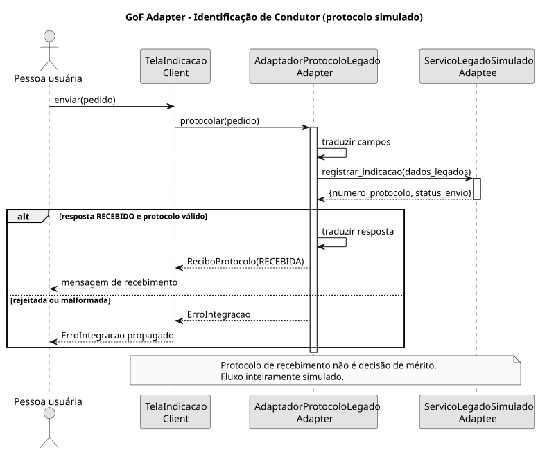
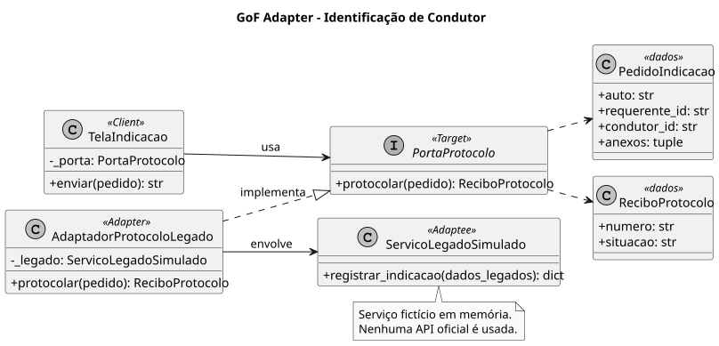

# SubEquipe_02

Relatório de **Felipe Henrique Oliveira Sousa** no fluxo de **Identificação de Condutor**, com aplicação do padrão estrutural **Adapter** em Python.

## Foco do Relatório

### FOCO_02: GoFs Estruturais & IA Generativa

**Entrega mínima:** um GoF Estrutural, com modelo, código e vídeo com o padrão em execução.


### Participantes no Foco_02

| Nome do Membro | Item Elaborado |
|---|---|
| Felipe Henrique Oliveira Sousa | Contexto do problema e aplicação do Adapter |
| Felipe Henrique Oliveira Sousa | Diagramas de classes e sequência |
| Felipe Henrique Oliveira Sousa | Implementação Python e demonstração no terminal |
| Felipe Henrique Oliveira Sousa | Documentação e análise do uso de IA |

### GoF Estrutural — Adapter

#### Contexto (Problema)

No recorte proposto para o fluxo de **Identificação de Condutor**, a aplicação reúne o identificador do auto de infração, o requerente, o condutor indicado e referências aos anexos. Ao enviar a solicitação, o cliente espera chamar `protocolar(pedido)` e receber um objeto `ReciboProtocolo`.

O serviço simulado oferece uma interface diferente: `registrar_indicacao(dados_legados)`, que recebe e devolve dicionários com campos próprios. Se a tela o acessasse diretamente, precisaria conhecer esses campos e interpretar sua resposta. Essa dependência espalharia os detalhes de integração pelo cliente.

O **Adapter** resolve essa incompatibilidade ao converter a interface do serviço para aquela esperada pela aplicação (GAMMA et al., 1994). `AdaptadorProtocoloLegado` recebe o pedido, traduz os campos, chama o serviço e converte a resposta em um recibo. Trata-se de um Adapter de objetos: o adaptador mantém uma referência ao serviço e delega a operação a ele.

O exemplo utiliza dados fictícios e um serviço em memória. `TelaIndicacao` representa o cliente do padrão no terminal. O protocolo confirma o recebimento da solicitação; a decisão administrativa sobre a indicação está fora do escopo.

#### Fundamentação das decisões

| Decisão | Fundamentação | Aplicação e evidência |
|---|---|---|
| Aplicar Adapter | Gamma et al. descrevem a conversão entre interfaces incompatíveis na seção [Adapter](https://www.informit.com/articles/article.aspx?p=1398600) do livro. | `protocolar(pedido)` é convertido em `registrar_indicacao(dados_legados)`; `test_traduz_entrada_e_saida_sem_deferir` verifica os dados enviados e recebidos. |
| Usar a variante de objetos | A variante por composição mantém uma instância do objeto adaptado e delega chamadas a ela, conforme a [motivação do padrão](https://www.informit.com/articles/article.aspx?p=1398600). | O atributo `_legado` recebe o serviço pelo construtor; a Figura 2 representa essa relação. |
| Declarar o Target com `Protocol` | A [especificação de tipagem do Python](https://typing.python.org/en/latest/spec/protocol.html) permite conformidade estrutural com os membros do protocolo. | `TelaIndicacao` depende de `PortaProtocolo`; `test_cliente_aceita_outra_implementacao_da_porta` demonstra a substituição da implementação. |
| Representar estrutura e interação | A [UML 2.5.1](https://www.omg.org/spec/UML/2.5.1) fornece a notação para classes, interfaces, mensagens e alternativas de interação. | A Figura 2 identifica os participantes; a Figura 1 acompanha o envio e os retornos de sucesso e falha. |

A decisão de aceitar somente uma resposta com número de protocolo e status `RECEBIDO` pertence ao contrato fictício deste estudo. Sua justificativa é evitar uma mensagem de sucesso sem confirmação válida. Os testes `test_rejeicao_nao_vira_recibo` e `test_resposta_sem_protocolo_falha_explicitamente` verificam essa decisão.

**Benefício e custo.** A tradução fica concentrada em uma classe, facilitando mudanças no contrato do serviço. Em contrapartida, surgem uma interface e uma camada de delegação que precisam ser mantidas. Se o serviço já atendesse diretamente a `PortaProtocolo`, uma implementação direta seria suficiente. O Adapter se justifica pela incompatibilidade definida no problema.

#### Modelagem (Notação UML)

##### Diagrama Sequencial



*Figura 1 | Elaboração: Felipe Henrique Oliveira Sousa.*

A sequência mostra a chamada do cliente, a tradução dos dados pelo adaptador e o retorno do serviço. Uma resposta com protocolo preenchido e status `RECEBIDO` produz um recibo. Uma resposta rejeitada ou sem protocolo produz `ErroIntegracao`.

##### Diagrama de Classes — Adapter



*Figura 2 | Elaboração: Felipe Henrique Oliveira Sousa.*

| Participante | Classe ou interface | Responsabilidade |
|---|---|---|
| **Client** | `TelaIndicacao` | Envia o pedido por meio de `PortaProtocolo` e apresenta o recibo. |
| **Target** | `PortaProtocolo` | Define a operação esperada: `protocolar(pedido)`. |
| **Adapter** | `AdaptadorProtocoloLegado` | Converte o pedido e a resposta entre os dois contratos. |
| **Adaptee** | `ServicoLegadoSimulado` | Disponibiliza a operação incompatível `registrar_indicacao(dados_legados)`. |

`PedidoIndicacao` e `ReciboProtocolo` transportam os dados de entrada e saída. A realização tracejada do diagrama representa a conformidade com `PortaProtocolo`. No Python, essa interface usa `typing.Protocol`, permitindo conformidade por tipagem estrutural, sem exigir herança explícita do adaptador. A anotação de tipo não valida automaticamente os valores retornados pelo serviço: essa verificação ocorre explicitamente em `AdaptadorProtocoloLegado.protocolar`.

#### Implementação (Código & Vídeo com Padrão em Execução)

##### Código Python

A implementação está em `codigo/indicacao_adapter.py` e utiliza apenas a biblioteca padrão do Python:

```python
"""Protótipo de Adapter para a identificação de condutor.

Todo o serviço externo é simulado em memória. Nenhuma chamada ao Detran-DF é feita.
"""
from __future__ import annotations

from dataclasses import dataclass
from typing import Protocol


@dataclass(frozen=True)
class PedidoIndicacao:
    auto: str
    requerente_id: str
    condutor_id: str
    anexos: tuple[str, ...] = ()

    def __post_init__(self) -> None:
        if not all((self.auto.strip(), self.requerente_id.strip(), self.condutor_id.strip())):
            raise ValueError("Auto, requerente e condutor são obrigatórios")


@dataclass(frozen=True)
class ReciboProtocolo:
    numero: str
    situacao: str


class PortaProtocolo(Protocol):
    """Target esperado pelo cliente da proposta móvel."""

    def protocolar(self, pedido: PedidoIndicacao) -> ReciboProtocolo: ...


class TelaIndicacao:
    """Client: depende só do contrato estável PortaProtocolo."""

    def __init__(self, porta: PortaProtocolo) -> None:
        self._porta = porta

    def enviar(self, pedido: PedidoIndicacao) -> str:
        recibo = self._porta.protocolar(pedido)
        return f"Solicitação recebida: {recibo.numero} ({recibo.situacao})"


class ServicoLegadoSimulado:
    """Adaptee fictício com assinatura e campos incompatíveis."""

    def __init__(self, situacao_resposta: str = "RECEBIDO") -> None:
        self.situacao_resposta = situacao_resposta
        self.chamadas: list[dict[str, object]] = []

    def registrar_indicacao(self, dados_legados: dict[str, object]) -> dict[str, object]:
        self.chamadas.append(dados_legados)
        return {
            "numero_protocolo": f"SIM-{len(self.chamadas):03d}",
            "status_envio": self.situacao_resposta,
        }


class ErroIntegracao(ValueError):
    """Resposta incompatível ou rejeitada pelo contrato simulado."""


class AdaptadorProtocoloLegado:
    """Adapter: converte chamada e resposta, sem decidir mérito da indicação."""

    def __init__(self, legado: ServicoLegadoSimulado) -> None:
        self._legado = legado

    def protocolar(self, pedido: PedidoIndicacao) -> ReciboProtocolo:
        dados_legados = {
            "numero_auto": pedido.auto,
            "id_solicitante": pedido.requerente_id,
            "id_indicado": pedido.condutor_id,
            "documentos": list(pedido.anexos),
        }
        resposta = self._legado.registrar_indicacao(dados_legados)
        numero = resposta.get("numero_protocolo")
        situacao = resposta.get("status_envio")
        if not isinstance(numero, str) or not numero.strip():
            raise ErroIntegracao("Resposta sem número de protocolo")
        if situacao != "RECEBIDO":
            raise ErroIntegracao(f"Envio não confirmado: {situacao!r}")
        return ReciboProtocolo(numero=numero, situacao="RECEBIDA")
```

`PedidoIndicacao` verifica se os identificadores estão preenchidos. O adaptador converte `auto`, `requerente_id`, `condutor_id` e `anexos` em `numero_auto`, `id_solicitante`, `id_indicado` e `documentos`. Após a chamada ao serviço, ele exige um protocolo não vazio e o status `RECEBIDO` para devolver `ReciboProtocolo`. A tela usa somente o contrato `PortaProtocolo`.

##### Demonstração do fluxo

O arquivo `codigo/demo.py` instancia o serviço, o adaptador e o cliente, e envia um pedido com dados fictícios:

```python
"""Execute com: python -m codigo.demo"""
from .indicacao_adapter import (
    AdaptadorProtocoloLegado,
    PedidoIndicacao,
    ServicoLegadoSimulado,
    TelaIndicacao,
)


def main() -> None:
    legado = ServicoLegadoSimulado()
    porta = AdaptadorProtocoloLegado(legado)
    tela = TelaIndicacao(porta)
    pedido = PedidoIndicacao(
        auto="AUTO-EXEMPLO-01",
        requerente_id="PESSOA-A",
        condutor_id="PESSOA-B",
        anexos=("anexo-ficticio.pdf",),
    )

    print("1. Cliente chama PortaProtocolo.protocolar(pedido)")
    print("2. Adapter chama ServicoLegadoSimulado.registrar_indicacao(dados)")
    print(tela.enviar(pedido))
    dados = legado.chamadas[0]
    print(f"3. Traduzido: numero_auto={dados['numero_auto']}, id_indicado={dados['id_indicado']}")
    print(f"   documentos={dados['documentos']}")
    print("4. Recebimento confirmado; não significa deferimento")


if __name__ == "__main__":
    main()
```

##### Como executar

Na raiz do repositório, execute:

```shell
python -m codigo.demo
```

Saída da demonstração:

```text
1. Cliente chama PortaProtocolo.protocolar(pedido)
2. Adapter chama ServicoLegadoSimulado.registrar_indicacao(dados)
Solicitação recebida: SIM-001 (RECEBIDA)
3. Traduzido: numero_auto=AUTO-EXEMPLO-01, id_indicado=PESSOA-B
   documentos=['anexo-ficticio.pdf']
4. Recebimento confirmado; não significa deferimento
```

A execução foi conferida com Python 3.14.6. Os cinco testes existentes verificam a tradução dos dados, a substituição da porta no cliente, a rejeição pelo serviço, a resposta sem protocolo e o pedido incompleto. Para executá-los:

```shell
python -m unittest discover -s tests -v
```

##### Vídeo com o padrão em execução


**Link do vídeo:** [Apresentação do código — Adapter no fluxo de Identificação de Condutor](https://youtu.be/40zCX5f92IM).


### Lições Aprendidas e Uso da IA Generativa (SENSO CRÍTICO)

| Nome do Membro | Lições aprendidas — relato de Felipe revisado textualmente com apoio de IA | Uso da IA Generativa |
|---|---|---|
| Felipe Henrique Oliveira Sousa | Meu principal aprendizado foi compreender que o Adapter permite integrar componentes com interfaces incompatíveis, inclusive ao conectar funcionalidades novas a partes já existentes do sistema. Percebi que sua aplicação exige atenção à lógica de conversão e às regras de negócio, para preservar o significado dos dados e o comportamento esperado. No fluxo de Identificação de Condutor, isso significa adaptar o envio e a resposta sem confundir a confirmação de recebimento com a aprovação da solicitação. | O Codex apoiou a organização do relatório, a implementação, os testes e os diagramas UML. A verificação comparou o código com o modelo e conferiu o resultado da execução. |


A IA auxiliou a preparação, e a execução forneceu evidência do comportamento do protótipo. Como o código e os testes foram preparados com apoio da mesma ferramenta, ambos podem repetir uma hipótese equivocada. A conferência com a literatura e a explicação humana complementam os testes. As conclusões sobre a integração se limitam ao serviço simulado; o exemplo não demonstra o contrato de uma API oficial.


## Versionamentos

| Nome do Membro | Contribuição | Commit | Data |
|---|---|---|---|
| Felipe Henrique Oliveira Sousa | Criação da estrutura inicial do relatório individual | [3fe27c2](https://github.com/UnBArqDsw2026-2-Turma02/2026.2-T02-_G6_ProjetoAplicativoMovel_Entrega03/commit/3fe27c226f4e200c4c6e5253cd22224ee5092440) | 16/10/2026 |
| Felipe Henrique Oliveira Sousa | Preenchimento do relatório com contexto do Adapter, modelagem, código Python e demonstração no texto, uso de IA e referências | [6a37a7a](https://github.com/UnBArqDsw2026-2-Turma02/2026.2-T02-_G6_ProjetoAplicativoMovel_Entrega03/commit/6a37a7a045ddcddfc3728423466760843f396492) | 16/10/2026 |
| Felipe Henrique Oliveira Sousa | Publicação dos diagramas de classes e sequência nos formatos PNG e SVG em `docs/Base/SubEquipe_2/imagens` | [85818e8](https://github.com/UnBArqDsw2026-2-Turma02/2026.2-T02-_G6_ProjetoAplicativoMovel_Entrega03/commit/85818e8709c43739e3abce501b5da55ae1895b05) | 16/10/2026 |
| Felipe Henrique Oliveira Sousa | Correção dos caminhos das imagens SVG e dos links PNG no relatório | [02e498c](https://github.com/UnBArqDsw2026-2-Turma02/2026.2-T02-_G6_ProjetoAplicativoMovel_Entrega03/commit/02e498cdb68dd89a6662b4a89b59ab987208705d) | 16/10/2026 |
| Felipe Henrique Oliveira Sousa | Revisão para a entrega mínima, fundamentação das decisões, relato de aprendizado e análise crítica do uso de IA | [e417174](https://github.com/UnBArqDsw2026-2-Turma02/2026.2-T02-_G6_ProjetoAplicativoMovel_Entrega03/commit/e417174d222b1a7220023fa6c9e26bb45297bc9f) | 17/10/2026 |
| Felipe Henrique Oliveira Sousa | Inclusão do link do vídeo de apresentação do código | [6d54fc9](https://github.com/UnBArqDsw2026-2-Turma02/2026.2-T02-_G6_ProjetoAplicativoMovel_Entrega03/commit/6d54fc91934463ae6f490a6b0d0fe49a53920fca) | 18/10/2026 |

## Referências

GAMMA, Erich; HELM, Richard; JOHNSON, Ralph; VLISSIDES, John. **Design Patterns: Elements of Reusable Object-Oriented Software**. Addison-Wesley, 1994. Padrão Adapter. Disponível em: [catálogo da editora Pearson](https://www.pearson.com/en-us/subject-catalog/p/design-patterns-elements-of-reusable-object-oriented-software/P200000009480/9780321700698). Acesso em: 16 out. 2026.

OBJECT MANAGEMENT GROUP. **Unified Modeling Language (UML), version 2.5.1**. 2017. Disponível em: [especificação oficial](https://www.omg.org/spec/UML/2.5.1). Acesso em: 16 out. 2026.

PYTHON SOFTWARE FOUNDATION. **typing — Support for type hints: typing.Protocol**. Documentação do Python 3.12. Disponível em: [documentação oficial](https://docs.python.org/3.12/library/typing.html#typing.Protocol). Acesso em: 16 out. 2026.

GAMMA, Erich; HELM, Richard; JOHNSON, Ralph; VLISSIDES, John. **Design Patterns: Adapter**. Excerto de *Design Patterns: Elements of Reusable Object-Oriented Software*. InformIT, 23 out. 2009. Disponível em: [intenção e motivação do Adapter](https://www.informit.com/articles/article.aspx?p=1398600). Acesso em: 17 out. 2026.

PYTHON SOFTWARE FOUNDATION. **Protocols**. Especificação do sistema de tipos do Python. Disponível em: [especificação oficial de protocolos](https://typing.python.org/en/latest/spec/protocol.html). Acesso em: 17 out. 2026.
