# SubEquipe_02

Relatório individual de **Matheus Pinheiro**, integrante da **SubEquipe_02**, sobre padrão estrutural.

## Foco do Relatório

### FOCO_02: GoFs Estruturais & IA Generativa

**Entrega mínima:** modelo, código e demonstração em vídeo de um GoF estrutural em execução.

### Participantes no Foco_02

| Nome do membro | Contribuição neste foco |
|---|---|
| Matheus Pinheiro | Análise do fluxo de infrações por meio do tutorial da CNH Digital do Senatran e diagramação e implementação do sistema utilizando Adapter, Facade e Strategy. Algumas funcionalidades, como declarar real infrator e o sistema de notificações, não foram consideradas. |

# Metodologia do Foco_02

Nesta contribuição individual, analisei o sistema por meio do [tutorial do Senatran](https://portalservicos.senatran.serpro.gov.br/static/carteiradigital/tutoriais/html/demo_21.html). Com base nessa análise, elaborei um diagrama inicial utilizando Adapter, Facade e Strategy; em seguida, implementei o sistema em C++ e revisei o diagrama para refletir as alterações feitas durante a implementação.

As integrações externas e os serviços de plataforma foram simulados por mocks. Os dados persistidos usados pelo protótipo ficam em arquivos TXT; portanto, o código demonstra contratos e fluxos simulados, não integrações reais com os serviços do Senatran ou do Gov.br.

## Reuniões

Foi realizado 1 reunião gravada entre eu e o outro integrante (felipe), onde nós aprentamos o que haviamos feito e demos nosso feedback, a parte de apresentação que foi gravada da apresentação pode ser encontrada em [https://www.youtube.com/watch?v=JYAcBS6vI84](https://www.youtube.com/watch?v=JYAcBS6vI84)

## Fluxo do sistema - referências visuais

As imagens a seguir registram telas do tutorial utilizado como referência para compreender o fluxo do aplicativo. Abra cada etapa para visualizar as telas relacionadas. Elas ilustram o fluxo observado e não significam que as APIs mockadas do projeto realizem essas operações reais.

<details>
<summary>Mostrar o fluxo visual do sistema</summary>

<details>
<summary>1. Login</summary>

<p>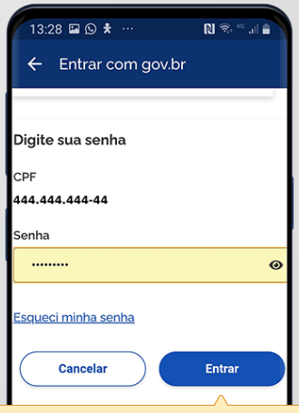</p>
<p><em>O usuário informa CPF e senha para entrar.</em></p>

</details>

<details>
<summary>2. Acesso às consultas de infrações</summary>

<p></p>
<p><em>O tutorial apresenta as consultas por infrator e por veículo.</em></p>

<p>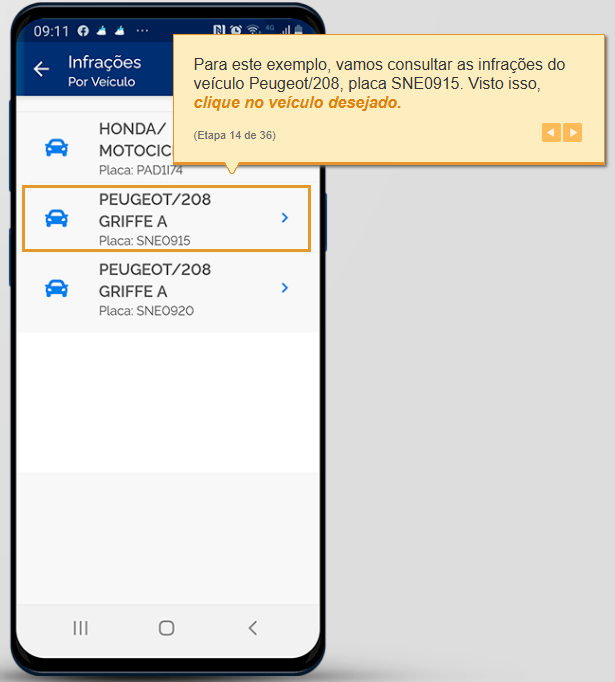</p>
<p><em>Na consulta por veículo, o usuário escolhe um dos veículos listados.</em></p>

<p>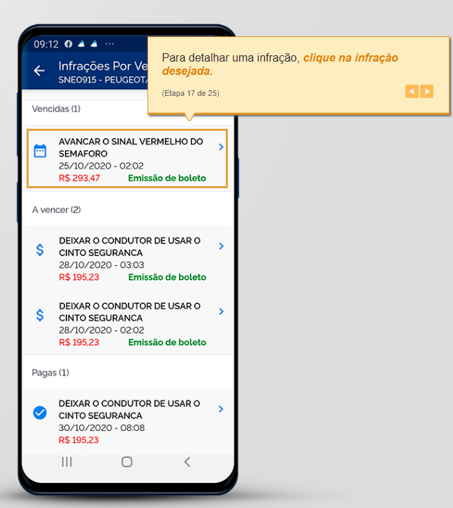</p>
<p><em>Exemplo de infrações exibidas para o veículo selecionado, com opção relacionada à adesão ao SNE.</em></p>

</details>

<details>
<summary>3. Detalhes e opções da infração</summary>

<p>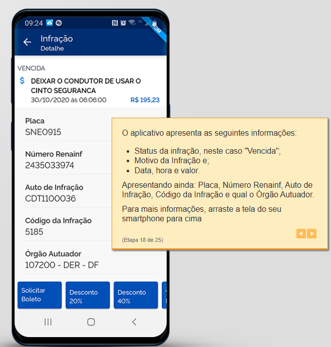</p>
<p><em>A tela apresenta dados da infração e ações como solicitar boleto e escolher desconto.</em></p>

<p>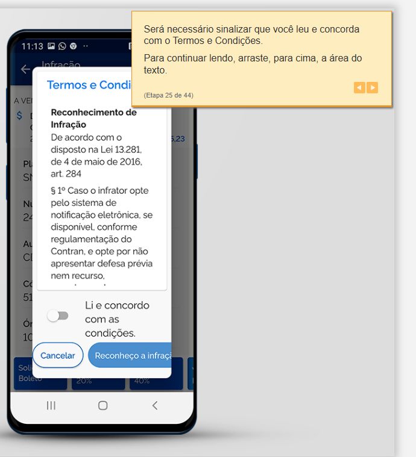</p>
<p><em>Exemplo da etapa de leitura e aceite do termo de reconhecimento.</em></p>

</details>

<details>
<summary>4. Adesão ao SNE</summary>

<p>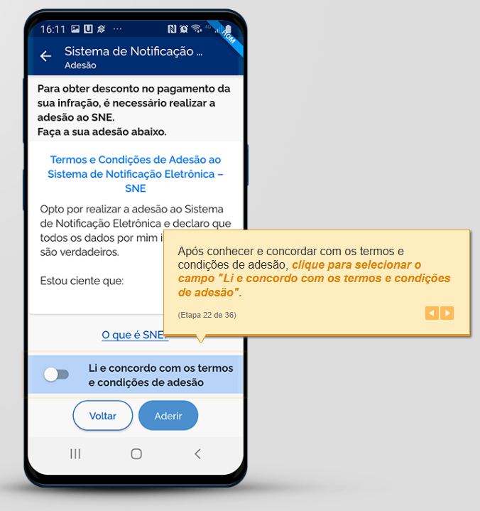</p>
<p><em>O usuário pode ler e aceitar os termos de adesão.</em></p>

<p>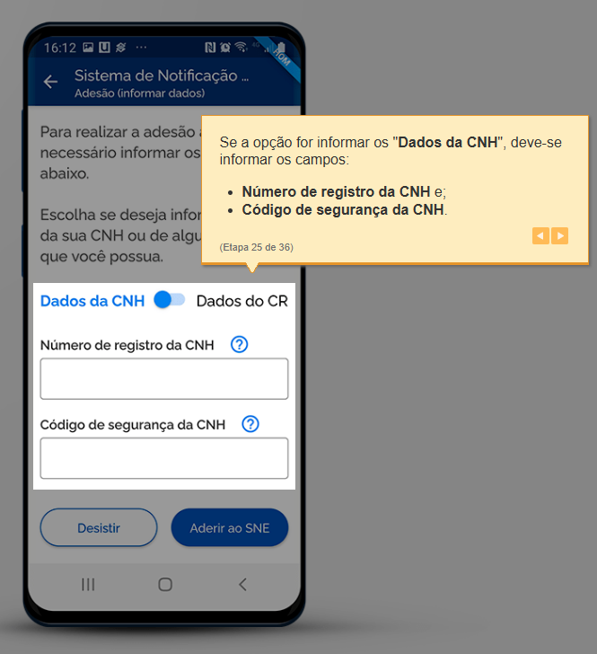</p>
<p><em>O tutorial mostra o preenchimento dos dados da CNH ou do CRLV para validar a adesão.</em></p>

<p>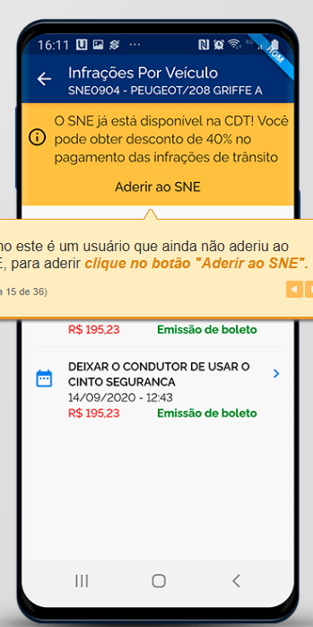</p>
<p><em>A tela informa a disponibilidade da adesão ao SNE durante a consulta de infrações.</em></p>

</details>

<details>
<summary>5. Ações sobre documentos</summary>

<p>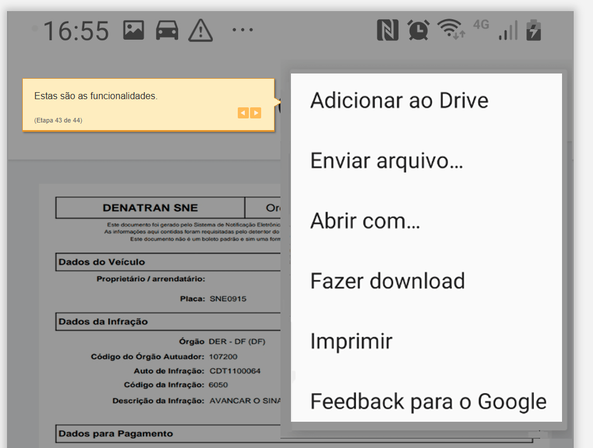</p>
<p><em>As opções ilustradas - abrir, baixar, compartilhar e imprimir - contextualizam as operações de documento representadas pelo Adapter no código.</em></p>

</details>

</details>

## GoF Estrutural - Adapter

### Contexto (Problema)

Pela análise do fluxo, a aplicação precisa conversar com componentes que podem oferecer contratos diferentes daqueles que o restante do sistema deseja usar. O padrão **Adapter** permite concentrar essa adaptação em um componente, reduzindo o acoplamento do cliente com a interface concreta. Neste protótipo, o LoginGov ilustra esse papel: o cliente chama o contrato `GatewayAutenticacao`, e o adapter consulta uma API mockada baseada em arquivo TXT, valida as credenciais e converte o registro para os tipos usados pela aplicação.

As APIs e plataformas externas não são integrações reais neste projeto: são representadas por mocks e arquivos TXT. Assim, a manutenção isolada do adapter é uma motivação arquitetural do exemplo, não uma comprovação de integração ou substituição de uma API de produção.

Além disso, subsistemas com várias operações foram reunidos por **Facades**, como nos fluxos de SNE e infrações.

#### Extra:

Também foi utilizado o padrão comportamental **Strategy**, detalhado em uma seção complementar.


# Modelagem (Notação UML)

A modelagem foi feita manualmente pela plataforma [lucidChart](https://lucid.app/documents#/documents?folder_id=home), que segue a notação UML
Obs: Nessa diagramação os tipos de retorno e algumas outras informações estão ocultas para reduzir a poluição visual


## Adapter

<details>
<summary>Exemplo de Adapter do Refactoring.Guru</summary>

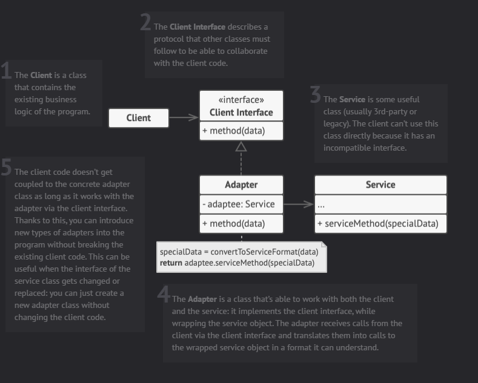

</details>

<details>
<summary>Diagrama do Adapter aplicado ao LoginGov</summary>

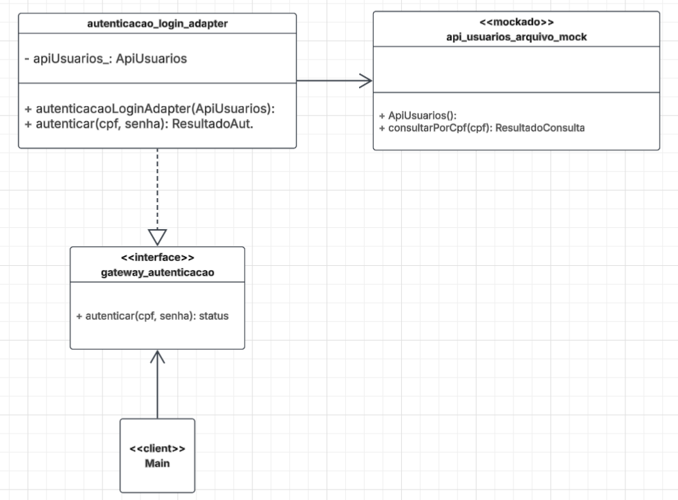

Fonte: Matheus Pinheiro.

</details>

| Papel no padrão | Elemento do sistema |
|---|---|
| **Client** | `main` | 
| **Target** | `GatewayAutenticacao` | 
| **Adapter** | `AutenticacaoLoginAdapter` | 
| **Adaptee** | `ApiUsuariosArquivoMock` | 


## Facade

<details>
<summary>Exemplo de Facade do Refactoring.Guru</summary>

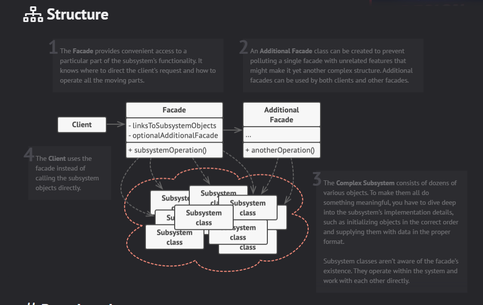

</details>

<details>
<summary>Diagrama da Facade do SNE</summary>

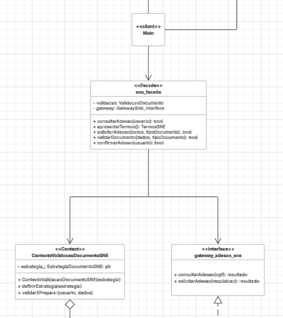

Fonte: Matheus Pinheiro.

</details>

| Papel no padrão | Elemento do sistema | 
|---|---|
| **Client** | `main` |
| **Facade** | `SNEFacade` | 
| **Subsystem** | `ContextoValidacaoDocumentoSNE` | 
| **Subsystem** | `gateway_adesao_sne` |


## Modelagem Completa

<details>
<summary>Diagrama completo de infrações — versão final</summary>

.svg)

Fonte: Matheus Pinheiro.

</details>

<details>
<summary>Diagrama completo de infrações — versão 1</summary>

Rascunho inicial da diagramação:
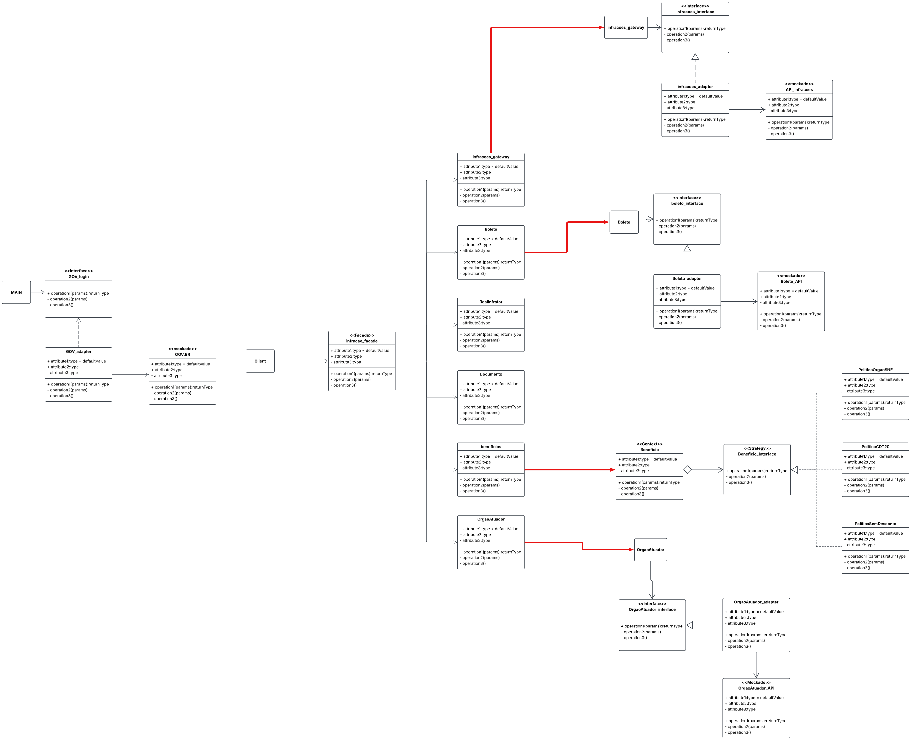

Fonte: Matheus Pinheiro.

</details>

<details>
<summary>Diagrama completo de infrações — versão 2</summary>

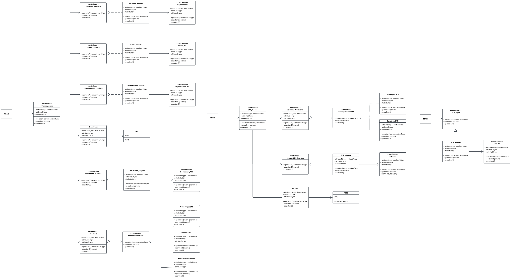

Fonte: Matheus Pinheiro.

</details>

<details>
<summary>Diagrama completo de infrações — versão 3</summary>

Apresentado na reunião
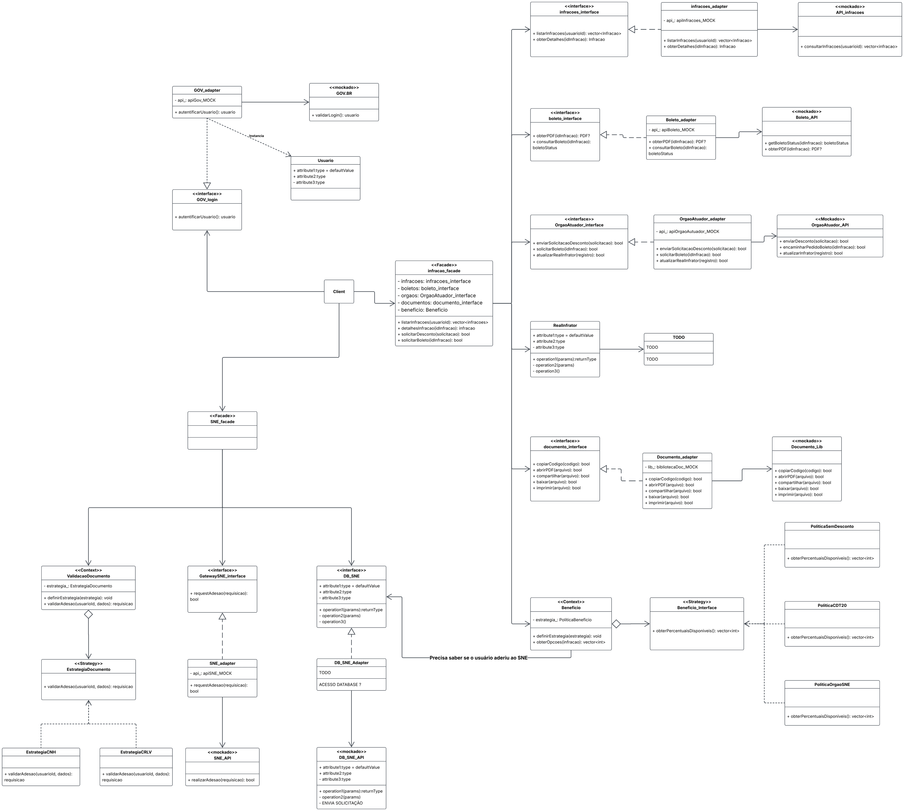

Fonte: Matheus Pinheiro.

</details>

<details>
<summary>Diagrama completo de infrações — versão 4</summary>

Pré-implementação
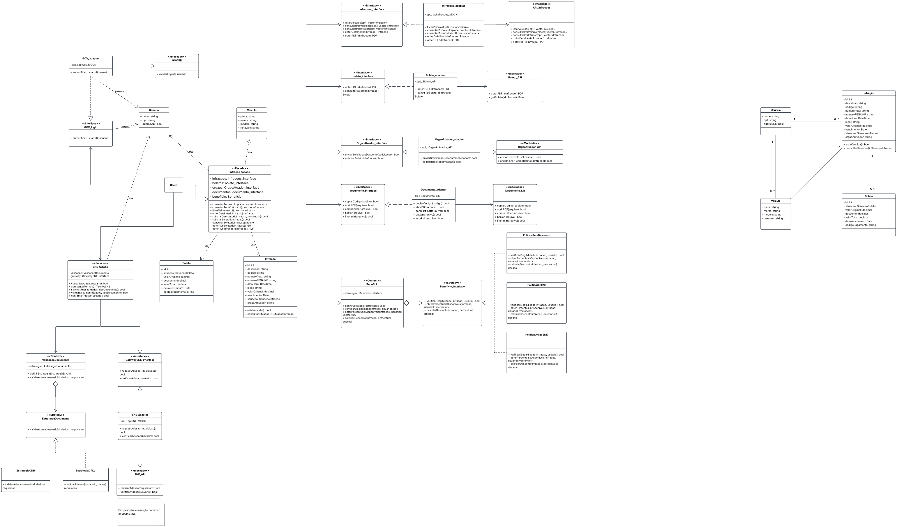

Fonte: Matheus Pinheiro.

</details>

<details>
<summary>Diagrama gerado por IA a partir do código</summary>

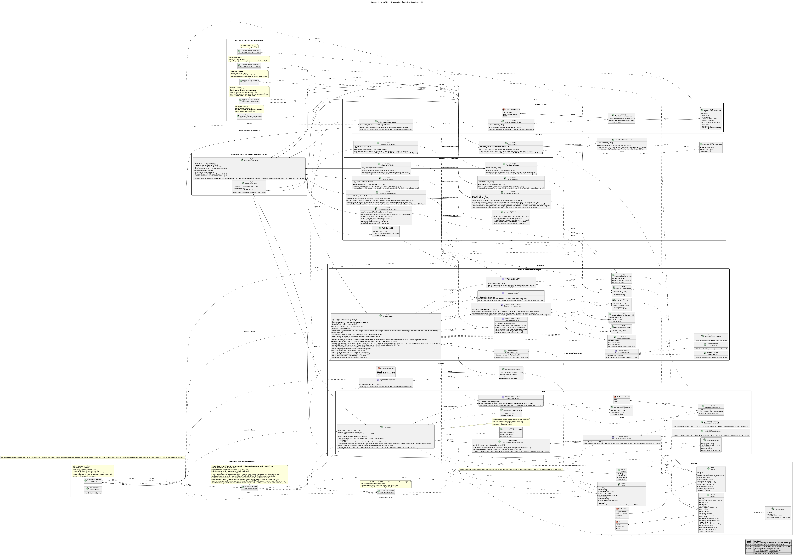

Fonte: diagrama gerado com o modelo Luna do GPT.

</details>

Acesso aos meus diagramas: [lucidChart](https://lucid.app/lucidchart/08cca27c-e026-4578-823d-b483ba160863/edit?viewport_loc=-6048%2C29044%2C4382%2C2243%2C0_0&invitationId=inv_2d34c798-8a7d-486c-9460-928f6d1f6977)

# Implementação (Código & Vídeo com Padrão em Execução)

#### Target: contrato esperado pelo cliente

`GatewayAutenticacao` define a operação de autenticação esperada pelo `main`:

```cpp
class GatewayAutenticacao {
public:
    virtual ~GatewayAutenticacao() = default;

    virtual ResultadoAutenticacao autenticar(
        const string& cpf,
        const string& senha) const = 0;
};
```

#### Adapter: implementação do Target e conversão

`AutenticacaoLoginAdapter` implementa o Target e mantém uma referência não proprietária ao Adaptee:

```cpp
class AutenticacaoLoginAdapter : public GatewayAutenticacao {
public:
    explicit AutenticacaoLoginAdapter(
        const ApiUsuariosArquivoMock& apiUsuarios);

    ResultadoAutenticacao autenticar(
        const string& cpf,
        const string& senha) const override;

private:
    const ApiUsuariosArquivoMock& apiUsuarios_;
};
```

O método consulta o usuário pelo CPF, trata erros e credenciais inválidas e converte o registro da fonte mockada para o modelo de domínio `Usuario`:

```cpp
ResultadoAutenticacao AutenticacaoLoginAdapter::autenticar(
    const string& cpf,
    const string& senha) const {
    const ResultadoConsultaUsuario consulta =
        apiUsuarios_.consultarPorCpf(cpf);

    if (consulta.status == StatusConsultaUsuario::ERRO) {
        return {StatusAutenticacao::ERRO, {}, consulta.mensagem};
    }

    if (consulta.status == StatusConsultaUsuario::NAO_ENCONTRADO ||
        consulta.registro.senha != senha) {
        return {StatusAutenticacao::CREDENCIAIS_INVALIDAS, {},
                "CPF ou senha inválidos."};
    }

    Usuario usuario;
    usuario.cpf = consulta.registro.cpf;
    usuario.nome = consulta.registro.nome;
    usuario.aderiuSNE = consulta.registro.aderiuSNE;
    usuario.numeroCNH = consulta.registro.numeroCNH;
    usuario.codigoSegurancaCNH = consulta.registro.codigoSegurancaCNH;
    usuario.placa = consulta.registro.placa;
    usuario.renavam = consulta.registro.renavam;
    usuario.numeroSegurancaCRV = consulta.registro.numeroSegurancaCRV;

    return {StatusAutenticacao::AUTENTICADO, usuario, {}};
}
```

O `main` cria a API mockada e o adapter, mas mantém o adapter através do tipo Target. A chamada do cliente, portanto, depende da interface `GatewayAutenticacao`:

```cpp
ApiUsuariosArquivoMock apiUsuarios(caminhoArquivo);
unique_ptr<GatewayAutenticacao> autenticacao =
    make_unique<AutenticacaoLoginAdapter>(apiUsuarios);

resultado = autenticacao->autenticar(cpf, senha);
```

**Compilação e execução:** com `g++` instalado e disponível no `PATH`, a partir da pasta [`codigo/codigoMatheus/`](./codigo/codigoMatheus/), use o comando no Bash:

```bash
g++ -std=c++17 -Wall -Wextra -Wpedantic -I . main.cpp $(find Aplicacao Infraestrutura -name '*.cpp' -print) -o sistema.exe

./sistema.exe
```

## Passo a passo para gravar o sistema

Os arquivos de exemplo foram preparados para mostrar três situações: uma infração com opções de **20% e 40%**, uma com **somente 20%** e uma **vencida, sem desconto disponível**. Os registros de boleto e as solicitações do órgão começam vazios para que o vídeo possa focar na consulta dos percentuais sem reutilizar resultados de execuções anteriores.

### Preparação

1. Abra o Git Bash (ou outro terminal Bash) na pasta `codigo/codigoMatheus`.
2. Compile e inicie o sistema com os comandos acima.
3. Entre com os dados de demonstração:

   ```text
   CPF: 12345678901
   Senha: senha123
   ```

4. O arquivo `Infraestrutura/SNE/Mock/adesoes_sne.txt` já contém esse CPF. A consulta ao SNE confirma a adesão, permitindo demonstrar a disponibilidade de 40% sem interromper o vídeo para preencher o formulário.

### Mostrar 40%, somente 20% e infração vencida

1. No menu de infrações, escolha **2 — Consultar por infrator**. A lista de demonstração contém:
   - `INF-001`: infração a vencer de órgão aderente ao SNE; deve apresentar **20% e 40%**.
   - `INF-002`: infração vencida; deve apresentar a mensagem de que não há descontos disponíveis.
   - `INF-003`: infração a vencer de órgão que oferece apenas desconto CDT; deve apresentar **somente 20%**.
2. Selecione `1 — INF-001`, escolha **2 — Consultar/solicitar desconto** e mostre `20% 40%`. Digite **0** para voltar sem registrar pedido.
3. Selecione `3 — INF-003`, escolha **2 — Consultar/solicitar desconto** e mostre `20%`. Digite **0** para voltar sem registrar pedido.
4. Selecione `2 — INF-002`. Escolha **1 — Consultar detalhes** para mostrar a situação **Vencida** e o vencimento em `10/10/2026`. Volte, escolha **2 — Consultar/solicitar desconto** e mostre a mensagem de que não há descontos disponíveis.
5. Encerre voltando pelos menus e escolhendo **0 — Voltar**.

**Por que os resultados diferem:** a política de benefício retorna 20% e 40% quando o órgão aderiu ao SNE; retorna somente 20% quando o órgão oferece o desconto CDT; e não retorna opções quando a situação da infração não é `A_VENCER`. O usuário de demonstração consta no arquivo de adesões SNE.

### Arquivos de dados preparados

- `Infraestrutura/Infracoes/Infracoes/Mock/infracoes.txt`: três registros, um para cada cenário acima.
- `Infraestrutura/Infracoes/Boleto/Mock/boletos.txt`: somente o cabeçalho, evitando boletos anteriores que poderiam alterar a demonstração.
- `Infraestrutura/Infracoes/OrgaoAutuador/Mock/orgaodesconto.txt` e `orgaoboleto.txt`: somente os cabeçalhos; o roteiro acima não registra pedidos porque usa `0` nas opções de percentual.
- `Infraestrutura/LoginGov/Mock/usuarios.txt` e `Infraestrutura/SNE/Mock/adesoes_sne.txt`: mantêm os dados de login e a adesão SNE do usuário de demonstração.

### Video de execução

[Execução do codigo](https://youtu.be/0eEXLCixxi0)


## Lições Aprendidas e Uso da IA Generativa (Senso Crítico)

| Nome do membro | Lições aprendidas | Uso da IA Generativa |
|---|---|---|
| Matheus Pinheiro | Aprendi a identificar problemas de manutenção e avaliar quais padrões podem ajudar a reduzir o acoplamento. Também aprendi a comparar os papéis do padrão com as responsabilidades que o código realmente implementa, distinguindo adaptações reais de simples encaminhamento para mocks. | A IA generativa ajudou na criação das aplicações que leem arquivos TXT e dos mocks. Também usei a IA para elaborar uma proposta de diagrama a partir do código; como ela ficou visualmente poluída, comparei seus componentes por partes com minha versão simplificada e com o código-fonte. |

## Versionamentos

| Nome do membro | Contribuição | Data |
|---|---|---|
| Matheus Pinheiro | Revisão do relatório individual: correção dos papéis do Adapter de LoginGov e da Facade do SNE, alinhamento dos trechos de implementação e explicitação das diferenças entre os mocks do projeto e os exemplos do Refactoring.Guru. | 19/10/2026 |

## Referências

REFACTORING.GURU. **Adapter**. Disponível em: [https://refactoring.guru/design-patterns/adapter](https://refactoring.guru/design-patterns/adapter). Acesso em: 19 out. 2026.

REFACTORING.GURU. **Facade**. Disponível em: [https://refactoring.guru/design-patterns/facade](https://refactoring.guru/design-patterns/facade). Acesso em: 19 out. 2026.

REFACTORING.GURU. **Strategy**. Disponível em: [https://refactoring.guru/design-patterns/strategy](https://refactoring.guru/design-patterns/strategy). Acesso em: 19 out. 2026.

OBJECT MANAGEMENT GROUP. **Unified Modeling Language (UML), version 2.5.1**. Disponível em: [https://www.omg.org/spec/UML/2.5.1](https://www.omg.org/spec/UML/2.5.1). Acesso em: 19 out. 2026.
